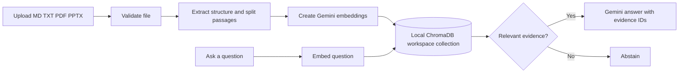

# Runbook RAG

An upload-first, evidence-grounded knowledge assistant. A workspace starts empty; a user adds Markdown, plain text, text-based PDF, or PowerPoint documents, the app indexes section-aware passages with Gemini embeddings, and questions are answered from retrieved passages with citations. When the evidence is weak, the assistant abstains.

This is a local, single-workspace portfolio prototype. It demonstrates the document-to-answer path; it is not a production multi-tenant service.

## Product flow



## What it demonstrates

- Upload-time validation and structure-aware extraction for Markdown, TXT, PDF pages, and PPTX slides
- Retained page and slide metadata in citations
- Gemini embeddings and generation
- ChromaDB vector search with workspace metadata filtering
- A relevance gate for low-confidence retrieval
- Evidence-grounded answers with traceable passage IDs
- A separate retrieval benchmark comparing baseline chunks with curated knowledge units

The curated knowledge units are a retrieval representation; they do **not** fine-tune Gemini.

## Quick start

### 1. Install

```powershell
git clone https://github.com/iamprajjwalhere-cpu/runbook-rag.git
Set-Location runbook-rag
py -m venv .venv
.\.venv\Scripts\python.exe -m pip install -r requirements.txt
```

### 2. Add your Gemini API key

```powershell
Copy-Item .env.example .env
```

Open `.env`, replace the placeholder with your Gemini API key, and save. Never commit `.env`; it is excluded by `.gitignore`.

### 3. Start the app

```powershell
.\.venv\Scripts\python.exe -m streamlit run app.py
```

Open the local URL Streamlit prints. Upload a `.md`, `.txt`, text-based `.pdf`, or `.pptx` file under **Documents**, then use **Ask your knowledge base** to search it. The app accepts files up to 5 MB. Scanned PDFs are detected when they have no selectable text; OCR is not included yet.

Run the tenant-scope regression checks with:

```powershell
.\.venv\Scripts\python.exe -m unittest discover -s tests
```

### 4. Run the sample-corpus retrieval evaluation

The included SRE runbooks and typed knowledge units provide a separate reproducible benchmark:

```powershell
.\.venv\Scripts\python.exe index_data.py
.\.venv\Scripts\python.exe evaluate_retrieval.py
```

The command builds the benchmark collections in the local `chroma_db/` directory. They are separate from the upload workspace collection.

## Evaluation

On a hand-labeled set of 24 questions across five sample SRE runbooks:

| Retrieval method | Hit@3 | MRR |
|---|---:|---:|
| Baseline chunks | 24/24 (100%) | 0.958 |
| Typed knowledge units | 24/24 (100%) | 0.958 |

The methods tie on this small dataset. The knowledge units add explicit topic, type, source, and stable ID metadata, but the evaluation does not show a ranking improvement. Hit@3 and MRR measure retrieval ranking, not answer correctness. The benchmark does not measure documents uploaded to the workspace.

## Prototype boundaries

- The app supports Markdown, UTF-8 text, text-based PDF, and PPTX. DOCX, spreadsheets, and OCR are not implemented; scanned PDF pages without text are flagged.
- PDF text is extracted page by page; complex multi-column layouts and tables may not retain their original structure. PowerPoint text and tables are extracted by slide; charts and text embedded in images are not parsed.
- The workspace ID is a fixed local-demo value. There is no sign-in, tenant provisioning, or production-grade tenant isolation. Do not upload sensitive company documents.
- ChromaDB stores indexed passages locally. Original-file object storage, document versioning, and deletion audit history are not implemented.
- The 0.35 distance cutoff is provisional; it is not a universal confidence score.
- The SRE evaluation set is small and does not measure generated-answer quality.

## Tenant isolation status

Workspace operations require an explicit `tenant_id`. Each tenant maps to a separate opaque Chroma collection, and vector reads, searches, and deletes also apply an exact `tenant_id` metadata prefilter. Retrieval verifies returned metadata and drops records that do not match the requested tenant. `tests/test_tenant_isolation.py` checks cross-collection and misplaced-record leakage scenarios.

This protects against application mistakes; it is not a security boundary against hostile code or direct database access. The Streamlit demo supplies one fixed tenant ID and has no authenticated identity or membership check. RBAC/ABAC filters, database-level access controls, encryption configuration, alerting, and tenant-specific encryption keys remain production work. A production deployment must verify tenant membership before it creates a trusted tenant context and must keep vector storage behind a service that does not expose unrestricted collection access.

Use TLS in transit. At-rest encryption should be provided by the host disk/database layer; future production deployments should evaluate tenant-specific envelope keys managed by a key-management service. The local Chroma prototype does not implement tenant-specific encryption.

## Project structure

```text
app.py                      Streamlit workspace, document upload, and question UI
workspace_rag.py            Upload validation, chunking, workspace retrieval, answers
.streamlit/config.toml       Light UI theme and 5 MB upload limit
tests/                      Tenant-scope regression checks
gemini_client.py            Gemini API client and model calls
ingest.py                   Markdown section parsing and chunking
index_data.py               Build the separate sample-corpus benchmark index
knowledge_units.py           Curated knowledge-unit parsing and validation
retrieve.py                  Sample-corpus routing, retrieval, abstention, answers
evaluate_retrieval.py        Baseline-versus-knowledge-unit evaluation
data/runbooks/               Sample SRE benchmark documents
data/knowledge_units.jsonl   Curated benchmark evidence records
data/eval_questions.json     Hand-labeled benchmark questions
```

## Models and tools

- Python
- Google Gemini API: `gemini-embedding-2` and `gemini-3.5-flash-lite`
- ChromaDB for local vector storage
- Streamlit for the interface
- `python-dotenv` for local API-key loading

## Sample benchmark sources

- [Google SRE Book: Monitoring Distributed Systems](https://sre.google/sre-book/monitoring-distributed-systems/)
- [Google SRE Book: Handling Overload](https://sre.google/sre-book/handling-overload/)
- [Google SRE Book: Managing Incidents](https://sre.google/sre-book/managing-incidents/)
- [Google SRE Workbook: Implementing SLOs](https://sre.google/workbook/implementing-slos/)
- [Google SRE Workbook: Example Error Budget Policy](https://sre.google/workbook/error-budget-policy/)
- [Google SRE Workbook: Canarying Releases](https://sre.google/workbook/canarying-releases/)
